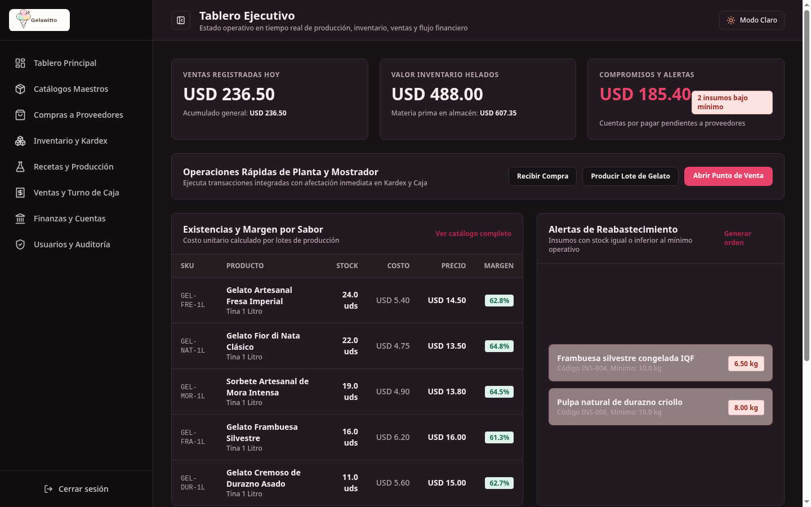
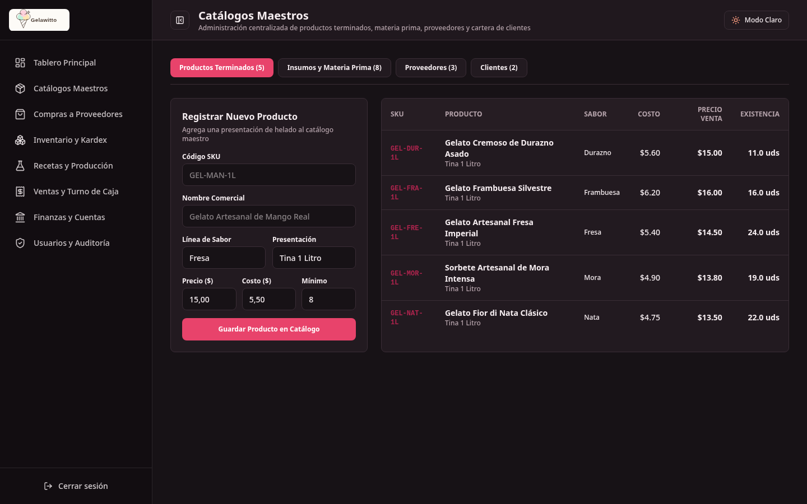
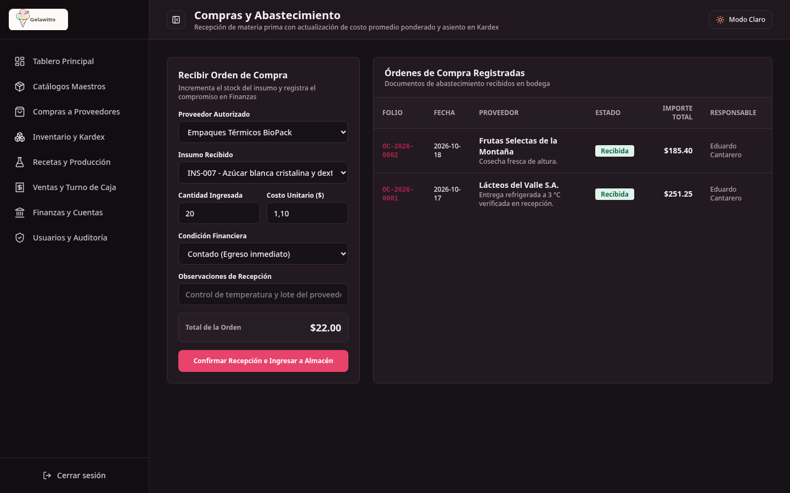
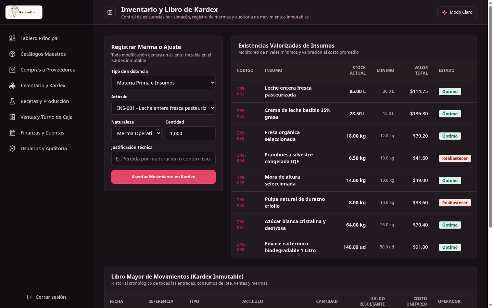
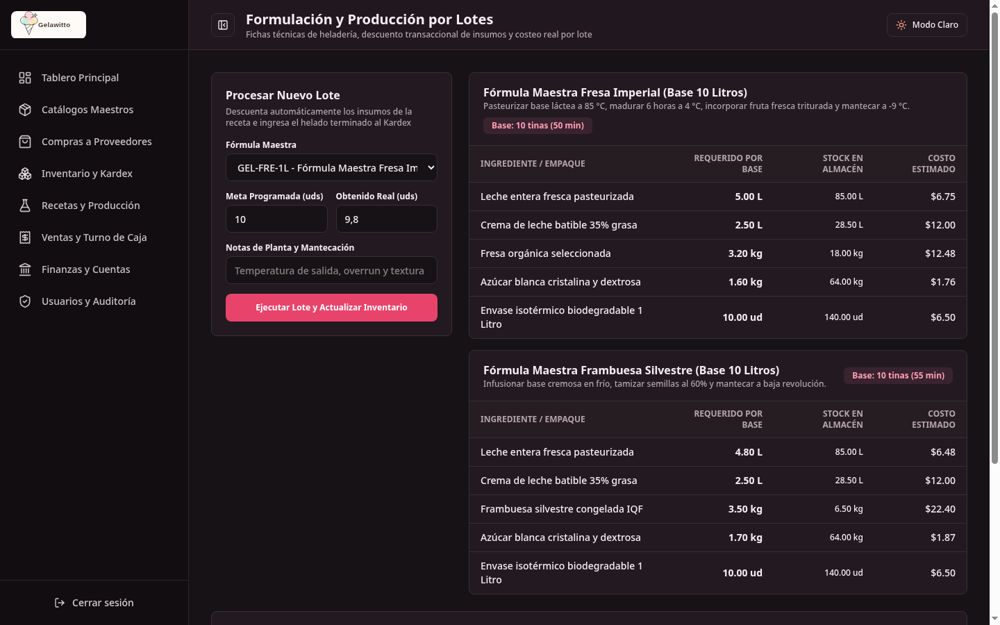
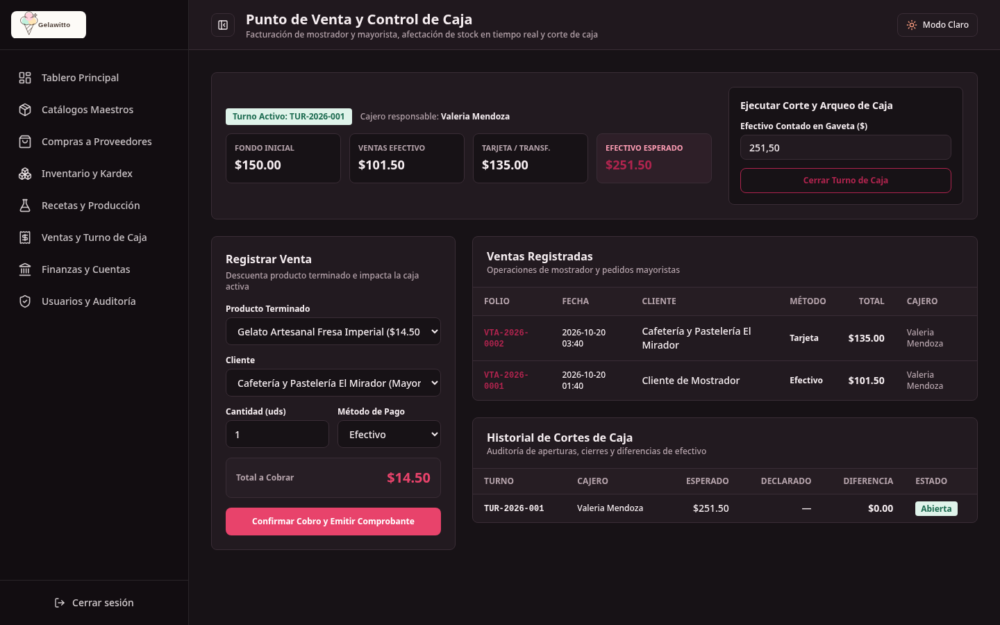
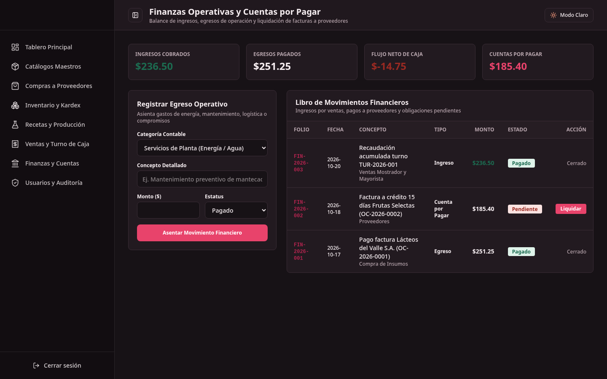
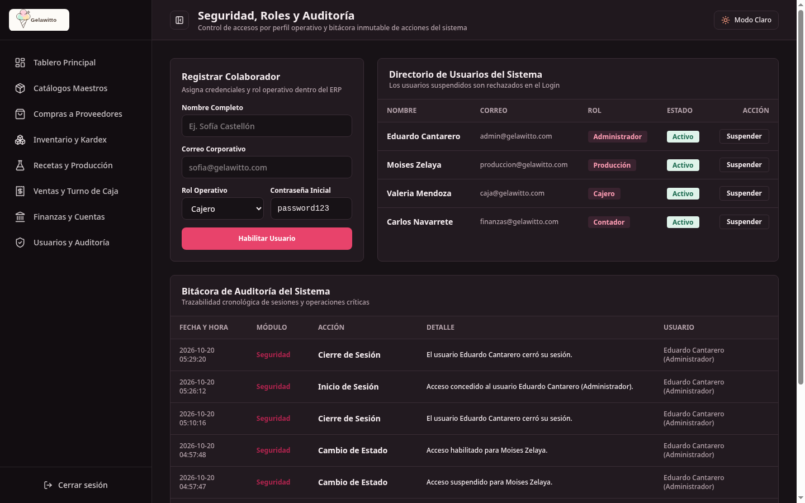

# Gelawitto ERP

Sistema integral de planificación de recursos empresariales para la heladería artesanal **Gelawitto**, diseñado para administrar catálogos maestros, compras a proveedores, inventario con libro de Kardex inmutable, formulación técnica y lotes de producción, punto de venta con control de turnos de caja, finanzas operativas con contabilidad de partida doble y auditoría de seguridad.

Construido bajo una arquitectura empresarial modular en capas con **Laravel**, **Vue 3 (Inertia.js + TypeScript)**, **Tailwind CSS v4** y **PostgreSQL 16**, combinando el patrón arquitectónico de repositorios, servicios, recursos y validaciones por dominio con la identidad visual de Gelawitto.

> **Acceso Rápido al Sistema (`http://localhost:8000` | Contraseña general: `password123`)**  
> **Administrador:** `admin@gelawitto.com`  
> **Producción:** `produccion@gelawitto.com`  
> **Caja (POS):** `caja@gelawitto.com`  
> **Contabilidad:** `finanzas@gelawitto.com`

---

## Acerca de la Empresa: Gelawitto Artesanal

**Gelawitto** es una empresa nicaragüense dedicada a la fabricación artesanal y comercialización de gelato italiano y sorbetes de fruta natural. El negocio abarca toda la cadena de valor de la industria de helados:

1. **Abastecimiento y Proveedores:** Compra de materia prima local (leche entera, crema para batir, pulpas de fruta fresca, azúcares y vasos reciclables) con costos registrados en Córdobas Nicaragüenses (`C$`).
2. **Formulación Técnica y Producción (BOM):** Estandarización de recetas maestras que calculan automáticamente la cantidad de insumos requeridos según el tamaño del lote, tiempos de maduración y mermas esperadas.
3. **Control de Calidad y Cadena de Frío:** Los lotes producidos entran en cuarentena obligatoria (`Pendiente`) hasta que Control de Calidad los inspecciona y libera para la venta. Además, se registran lecturas de temperatura en congeladores industriales.
4. **Punto de Venta (POS) y Mayoristas:** Ventas de mostrador al público general (efectivo, tarjeta, transferencia) y ventas a crédito para clientes comerciales (hoteles y restaurantes) con cálculo automático de IVA (15%).
5. **Contabilidad General y Finanzas:** Registro automático de asientos contables de partida doble ($\sum \text{Debe} = \sum \text{Haber}$) en el Libro Diario, control de cuentas por cobrar y por pagar, Estado de Resultados y Balance General.

---

## Guía Rápida para Principiantes: ¿Cómo instalar y correr el sistema desde cero?

Si acabas de clonar o descargar este proyecto y no tienes mucha experiencia configurando servidores o entornos de programación, **esta guía te llevará de la mano paso a paso**.

### 1. Programas que necesitas instalar primero (Solo una vez)
Descarga e instala estas herramientas gratuitas en tu computadora:

1. **Git:** [Descargar Git](https://git-scm.com/downloads) — *Para descargar y sincronizar el código.*
2. **PHP 8.3 o superior:** [Descargar PHP](https://www.php.net/) — *El lenguaje del backend. Si usas Windows o Mac, la opción más fácil y recomendada es instalar [Laravel Herd](https://herd.laravel.com/) o [Laragon](https://laragon.org/).*
3. **Composer:** [Descargar Composer](https://getcomposer.org/download/) — *El gestor de paquetes de PHP.*
4. **Node.js (versión 20 o superior):** [Descargar Node.js](https://nodejs.org/) — *Incluye `npm`, necesario para compilar las pantallas visuales.*
5. **PostgreSQL con pgAdmin 4:** [Descargar PostgreSQL](https://www.postgresql.org/download/) — *El motor donde se guardará la base de datos.*

---

### 2. Pasos para poner a correr el ERP

Abre tu terminal (**PowerShell** o **Símbolo del sistema** en Windows, o **Terminal** en Mac/Linux) y escribe los siguientes comandos en orden:

#### Paso 1: Clonar el repositorio y entrar a la carpeta
```bash
git clone https://github.com/CANTARERO8/erp-gelawitto.git
cd erp-gelawitto
```

#### Paso 2: Crear el archivo de configuración `.env`
- En Windows (PowerShell/CMD):
  ```powershell
  copy .env.example .env
  ```
- En Mac o Linux:
  ```bash
  cp .env.example .env
  ```

#### Paso 3: Configurar la base de datos en pgAdmin 4
1. Abre **pgAdmin 4**.
2. Da clic derecho en **Databases** -> **Create** -> **Database...**
3. Escribe de nombre: `gelawitto_erp` y da clic en **Save**.
4. Abre el archivo `.env` en la raíz del proyecto (con Bloc de Notas o VS Code) y verifica que tenga tus credenciales de PostgreSQL:
   ```env
   DB_CONNECTION=pgsql
   DB_HOST=127.0.0.1
   DB_PORT=5432
   DB_DATABASE=gelawitto_erp
   DB_USERNAME=postgres
   DB_PASSWORD=tu_contraseña_de_postgres
   ```
   *(Si utilizas el contenedor Docker incluido en el proyecto, el puerto configurado es `5433`)*.

#### Paso 4: Descargar las librerías del sistema
Ejecuta estos dos comandos en la terminal:
```bash
composer install
npm install
```

#### Paso 5: Generar la clave de seguridad de la aplicación
```bash
php artisan key:generate
```

#### Paso 6: Crear automáticamente todas las tablas y datos de prueba
Ejecuta este comando para construir todas las tablas y cargar recetas, helados, insumos y usuarios iniciales:
```bash
php artisan migrate:fresh --seed
```

#### Paso 7: Compilar la interfaz visual y encender el servidor
Compila los estilos y vistas:
```bash
npm run build
```
Y arranca el servidor web:
```bash
php artisan serve
```

---

### 3. ¿Cómo entrar al sistema?

Abre tu navegador (Chrome, Edge, Firefox, Brave) y entra a:
**[http://localhost:8000](http://localhost:8000)**

Inicia sesión con cualquiera de las cuentas creadas por el sistema:

| Rol de Trabajo | Correo de Acceso | Contraseña | ¿Qué funciones tiene asignadas? |
| :--- | :--- | :--- | :--- |
| **Administrador General** | `admin@gelawitto.com` | `password123` | Control total del sistema, seguridad, usuarios y auditoría inmutable. |
| **Jefe de Producción** | `produccion@gelawitto.com` | `password123` | Crear recetas, simulador MRP, programar lotes y control de calidad. |
| **Cajero / Punto de Venta** | `caja@gelawitto.com` | `password123` | Apertura de turno, cobro (mostrador/crédito) y arqueo de caja. |
| **Contador / Finanzas** | `finanzas@gelawitto.com` | `password123` | Libro Diario (Partida Doble), Balance General, Estado de Resultados y compras. |

---

## Equipo de Desarrollo

| Integrante | No. Carnet | Función Principal |
| :--- | :--- | :--- |
| **Eduardo Josué Córdova Cantarero** | `2021-0069I` | Arquitectura de Software y Backend Lead |
| **Richard Alexander Malespín Tinoco** | `2022-0323I` | Desarrollo de Módulos y Base de Datos |
| **Marlyng Elizabeth Miranda Navarrete** | `2022-0315I` | Desarrollo de Módulos e Integración |
| **Moisés Abraham Zelaya Maldonado** | `2022-0225I` | Desarrollo Frontend y Experiencia de Usuario |

---

## Tabla de Contenidos

1. [Acerca de la Empresa Gelawitto](#acerca-de-la-empresa-gelawitto-artesanal)
2. [Guía Rápida para Principiantes](#guía-rápida-para-principiantes-cómo-instalar-y-correr-el-sistema-desde-cero)
3. [Equipo de Desarrollo](#equipo-de-desarrollo)
4. [Arquitectura y Stack Tecnológico](#1-arquitectura-y-stack-tecnológico)
5. [Identidad Visual y Paleta de Colores](#2-identidad-visual-y-paleta-de-colores)
6. [Módulos Integrados del ERP](#3-módulos-integrados-del-erp)
7. [Requisitos Previos del Sistema](#4-requisitos-previos-del-sistema)
8. [Guía de Instalación Avanzada (Docker)](#5-guía-de-instalación-paso-a-paso-desde-cero)
9. [Guía Completa de Base de Datos: Inspección, Enlace y Clientes Visuales](#6-guía-completa-de-base-de-datos-inspección-enlace-y-clientes-visuales)
10. [Diccionario de Tablas del Esquema Relacional](#7-diccionario-de-tablas-del-esquema-relacional)
11. [Credenciales de Acceso al ERP](#8-credenciales-de-acceso-al-erp)
12. [Ejecución de Pruebas Automatizadas](#9-ejecución-de-pruebas-automatizadas)
13. [Solución de Problemas Frecuentes (Troubleshooting)](#10-solución-de-problemas-frecuentes-troubleshooting)
14. [Guía de Colaboración y Flujo de Trabajo en Git](#11-guía-de-colaboración-y-flujo-de-trabajo-en-git)
15. [Estructura Detallada de Archivos y Capas del Proyecto](#12-estructura-detallada-de-archivos-y-capas-del-proyecto)

---

## 1. Arquitectura y Stack Tecnológico

El sistema implementa una arquitectura modular desacoplada por dominios de negocio (`Catálogos`, `Compras`, `Inventario`, `Producción`, `Ventas`, `Finanzas`, `Seguridad` y `Dashboard`):

- **Backend y Reglas de Negocio:** Laravel con PHP 8.3+, estructurado en `Models`, `Repositories`, `Services`, `FormRequests`, `Resources` y `Controllers`. Implementa transacciones atómicas (`DB::transaction`) y bloqueo pesimista (`lockForUpdate`) en operaciones críticas de inventario y caja.
- **Interfaz Reactiva:** Vue 3 (Composition API + TypeScript) acoplado monolíticamente mediante Inertia.js sin necesidad de mantener una API REST separada.
- **Sistema de Diseño:** Tailwind CSS v4 con tokens personalizados y soporte nativo para modo claro y modo oscuro.
- **Tipografías Institucionales:** Fredoka (titulares y encabezados) e Inter (cuerpo de texto, formularios y tablas financieras).
- **Motor de Base de Datos:** PostgreSQL 16 (`postgres:16`) contenerizado en Docker con tipos numéricos exactos (`NUMERIC(12,2)` para moneda y `NUMERIC(12,3)` para pesaje e inventario).
- **Aseguramiento de Calidad:** PHPUnit (pruebas de integración transaccionales sobre PostgreSQL 16) y Vitest (validación de tokens de diseño y componentes).

---

## 2. Identidad Visual y Paleta de Colores

| Tono | Valor Hex | Variable CSS | Función en el sistema |
| :--- | :--- | :--- | :--- |
| **Fresa** | `#e8436b` | `--color-fresa` | Color primario, botones principales y acentos activos |
| **Frambuesa** | `#b0244e` | `--color-frambuesa` | Estados hover, folios de documentos y enlaces destacados |
| **Mora** | `#4a1430` | `--color-mora` | Estructura de navegación y barra lateral administrativa |
| **Durazno** | `#ff9e80` | `--color-durazno` | Acentos secundarios e indicadores cálidos |
| **Rubor** | `#fde7ec` | `--color-rubor` | Fondos suaves de selección y etiquetas de rol |
| **Nata** | `#fff9f7` | `--color-nata` | Lienzo principal de la aplicación en modo claro |
| **Tinta** | `#2a2126` | `--color-tinta` | Tipografía principal de alto contraste |

---

## 3. Módulos Integrados del ERP

El sistema cuenta con una interfaz con soporte completo para **Modo Oscuro** y **Modo Claro**, optimizada para sesiones prolongadas en planta de producción, almacén y puntos de venta:

### 3.1 Portal de Acceso y Autenticación (`/login`)


- **Distribución Split-Screen:** Fotografía artesanal a la izquierda y panel de autenticación limpio a la derecha con el isotipo oficial de Gelawitto.
- **Seguridad Operativa:** Alternador de visibilidad de contraseña, persistencia de sesión ("Recuérdame en este equipo") y blindaje automático contra ataques de fuerza bruta (bloqueo temporal de 60 segundos con cronómetro regresivo tras 5 intentos fallidos consecutivos).
- **Selector de Tema:** Alternador en esquina superior para conmutar al instante entre modo claro y modo oscuro.

### 3.2 Tablero Ejecutivo Principal (`/dashboard`)


- **Métricas en Tiempo Real:** Total de ventas del día, acumulado general, valorización financiera de inventario (helados y materia prima) y compromisos de pago.
- **Acceso Rápido Operativo:** Botones de acción directa para recepción de compras, producción de lotes y apertura de punto de venta.
- **Margen por Sabor y Alertas:** Tabla comparativa de rentabilidad porcentual por producto y alertas automáticas de insumos que han alcanzado su umbral mínimo de seguridad.

### 3.3 Catálogos Maestros (`/catalogos`)


- **Productos Terminados:** Registro y administración de sabores, presentaciones (tinas de 1L, etc.), costo unitario base y precio de venta al público.
- **Insumos y Materia Prima:** Clasificación por unidad de medida (`kg`, `L`, `ud`) con umbral mínimo para disparo de alertas.
- **Proveedores y Clientes:** Directorio comercial con condiciones comerciales, teléfonos y datos de contacto.

### 3.4 Compras y Abastecimiento (`/compras`)


- **Recepción de Mercancía:** Formulario guiado que asocia proveedor autorizado, insumo recibido, cantidad ingresada y costo unitario pactado.
- **Recálculo Ponderado:** Actualización en tiempo real del **costo promedio ponderado** del insumo sin desfase contable.
- **Afectación Doble:** Asiento inmediato en el Libro de Kardex y registro automático de la cuenta por pagar en Finanzas.

### 3.5 Control de Inventario y Kardex Inmutable (`/inventario`)


- **Existencias Valorizadas:** Visor de existencias en almacén con cálculo del valor económico total y estado operativo del stock.
- **Ajustes y Mermas Justificadas:** Registro de mermas con justificación técnica obligatoria y bloqueo pesimista contra saldos negativos.
- **Libro Mayor de Kardex:** Historial inmutable ordenado cronológicamente con folio referencial, tipo de movimiento, insumo/producto, cantidad, saldo resultante y operador responsable.

### 3.6 Formulación Técnica y Producción por Lotes (`/produccion`)


- **Fórmulas Maestras:** Especificaciones técnicas oficiales con requerimiento de materia prima por cada sabor base (leche fresca, crema batida, fruta, azúcares y empaques).
- **Procesamiento de Lotes:** Validación automática de disponibilidad de insumos en bodega, descuento transaccional en Kardex, cálculo del costo unitario real basado en mermas e ingreso del helado terminado al almacén.

### 3.7 Punto de Venta y Control de Turnos de Caja (`/ventas`)


- **Gestión de Turnos de Caja:** Apertura obligatoria con fondo inicial en gaveta, registro de cajero responsable y seguimiento del turno activo.
- **Cobro de Mostrador y Mayoristas:** Facturación ágil con soporte para efectivo, tarjeta o transferencia bancaria y deducción automática del stock.
- **Arqueo y Cierre de Caja:** Comparación contra el efectivo esperado según ventas registradas y emisión de diferencias para auditoría financiera.

### 3.8 Finanzas Operativas y Flujo de Caja (`/finanzas`)


- **Balance de Liquidez:** Métrica de ingresos cobrados, compras y egresos operativos pagados, junto con el flujo neto de efectivo.
- **Gastos de Planta:** Asiento contable de servicios operativos (electricidad, mantenimiento preventivo de mantecadoras, logística).
- **Liquidación de Cuentas por Pagar:** Listado de facturas pendientes a proveedores con botón de liquidación en un solo clic.

### 3.9 Administración de Usuarios, Roles y Auditoría (`/seguridad`)


- **Directorio de Colaboradores:** Creación de usuarios con roles asignados (`Administrador`, `Producción`, `Cajero`, `Contador`) y switch para suspender o activar cuentas inmediatamente.
- **Bitácora de Auditoría Inmutable:** Registro cronológico de accesos, cierres de sesión, suspensiones y operaciones clave para cumplimiento y trazabilidad interna.

---


## 4. Requisitos Previos del Sistema

Antes de clonar e instalar el proyecto, asegúrate de contar con las siguientes herramientas instaladas en tu sistema operativo (**Windows con WSL2/ Laragon/Herd**, **macOS** o **Linux**):

| Herramienta | Versión Mínima | Comando para verificar | Notas importantes |
| :--- | :--- | :--- | :--- |
| **PHP** | `8.3` o superior | `php -v` | Debe tener habilitadas las extensiones: `pdo_pgsql`, `pgsql`, `mbstring`, `xml`, `bcmath`, `curl`, `zip`. |
| **Composer** | `2.x` | `composer -V` | Gestor de dependencias de PHP. |
| **Node.js** | `20 LTS` / `22 LTS` | `node -v` | Entorno de ejecución para compilar el frontend Vue 3 + Vite. |
| **npm** | `10.x` o superior | `npm -v` | Se instala automáticamente junto con Node.js. |
| **Docker** *(Opcional pero recomendado)* | `24.x` + Compose v2 | `docker compose version` | Permite levantar PostgreSQL 16 en segundos sin instalarlo manualmente en el sistema. |
| **PostgreSQL** *(Solo si no usas Docker)* | `16.x` o superior | `psql --version` | Solo necesario si prefieres usar una instalación nativa de PostgreSQL en lugar de Docker. |

> **Nota sobre la extensión `pdo_pgsql`:**
> Si al ejecutar migraciones recibes el error `could not find driver`, significa que tu instalación de PHP no tiene activado el conector de PostgreSQL:
> - **Ubuntu / Debian:** `sudo apt install php-pgsql`
> - **Arch Linux:** Descomentar `extension=pdo_pgsql` y `extension=pgsql` en `/etc/php/php.ini`.
> - **Windows (Laragon / XAMPP):** Abrir `php.ini` y quitar el punto y coma (`;`) delante de `;extension=pdo_pgsql` y `;extension=pgsql`.
> - **macOS (Homebrew):** Viene incluido por defecto al instalar `brew install php`.

---

## 5. Guía de Instalación Paso a Paso (Desde Cero)

Sigue estos pasos en orden dentro de tu terminal para dejar el sistema funcionando al 100%:

### Paso 1: Clonar el repositorio e ingresar a la carpeta
```bash
git clone https://github.com/CANTARERO8/erp-gelawitto.git
cd "erp-gelawitto"
```

### Paso 2: Crear el archivo de variables de entorno (`.env`)
El repositorio incluye una plantilla lista llamada `.env.example`. Cópiala para crear tu archivo `.env` local:

- **En Linux / macOS / Git Bash:**
  ```bash
  cp .env.example .env
  ```
- **En Windows (PowerShell / CMD):**
  ```powershell
  copy .env.example .env
  ```

Abre el archivo `.env` con tu editor de código y define una contraseña para la base de datos en `DB_PASSWORD` (por ejemplo, `gelawitto_secret`):
```env
DB_CONNECTION=pgsql
DB_HOST=127.0.0.1
DB_PORT=5433
DB_DATABASE=gelawitto_erp
DB_USERNAME=gelawitto
DB_PASSWORD=gelawitto_secret
```

### Paso 3: Iniciar la base de datos PostgreSQL 16
Levanta el contenedor oficial de PostgreSQL 16 configurado en `docker-compose.yml`:
```bash
docker compose up -d
```
Verifica que el contenedor `gelawitto_db` esté corriendo y saludable (`healthy`):
```bash
docker compose ps
```
*(El contenedor expondrá PostgreSQL 16 en `127.0.0.1:5433` para no chocar con ningún otro PostgreSQL que tengas en el puerto `5432`).*

### Paso 4: Instalar las dependencias del Backend (PHP / Laravel)
```bash
composer install
```

### Paso 5: Generar la llave criptográfica de la aplicación
Laravel requiere una llave única (`APP_KEY`) para cifrar sesiones y cookies:
```bash
php artisan key:generate
```

### Paso 6: Instalar las dependencias del Frontend (Vue 3 / Tailwind / Vite)
```bash
npm install
```

### Paso 7: Crear las tablas y cargar los datos iniciales (Migraciones + Seeders)
Este comando se conecta a la base de datos, construye las 14 tablas del ERP y las puebla con los usuarios, roles, unidades de medida, proveedores, clientes, productos, insumos, recetas, turnos y ventas de demostración:
```bash
php artisan migrate:fresh --seed
```

### Paso 8: Compilar el frontend e iniciar el servidor
Tienes dos formas de correr el programa:

- **Modo estándar (Compilación + Servidor PHP):**
  ```bash
  npm run build
  php artisan serve
  ```
- **Modo desarrollo en vivo (Recarga en caliente con un solo comando):**
  ```bash
  composer run dev
  ```

Una vez iniciado, abre tu navegador web en:
**`http://localhost:8000`**

---

## 6. Guía Completa de Base de Datos: Inspección, Enlace y Clientes Visuales

### A. ¿Dónde ver la base de datos directamente desde GitHub?
Toda la arquitectura relacional y los datos iniciales están versionados dentro del repositorio para que cualquier persona pueda revisarlos sin descargar nada:

1. **Definición de Tablas del ERP (DDL):** [`database/migrations/0001_01_02_000000_create_erp_tables.php`](database/migrations/0001_01_02_000000_create_erp_tables.php)
2. **Definición de Usuarios y Sesiones:** [`database/migrations/0001_01_01_000000_create_users_table.php`](database/migrations/0001_01_01_000000_create_users_table.php)
3. **Datos Iniciales (Semillas / Seeders):** [`database/seeders/DatabaseSeeder.php`](database/seeders/DatabaseSeeder.php)
4. **Modelos Eloquent por Módulo:** [`app/Models/`](app/Models/)

### B. ¿Cómo conectarse desde un gestor visual (DBeaver, TablePlus, DataGrip o VS Code)?
Si deseas explorar las tablas gráficamente, ver los diagramas entidad-relación o ejecutar consultas SQL manuales mientras el contenedor está encendido, crea una nueva conexión **PostgreSQL** en tu gestor visual favorito con estos parámetros exactos:

| Parámetro | Valor |
| :--- | :--- |
| **Host / Servidor** | `127.0.0.1` (o `localhost`) |
| **Puerto (Port)** | `5433` |
| **Base de Datos (Database)** | `gelawitto_erp` |
| **Usuario (Username)** | `gelawitto` |
| **Contraseña (Password)** | El valor que pusiste en `DB_PASSWORD` dentro de tu `.env` |

### C. ¿Cómo entrar a la consola SQL (`psql`) desde la terminal?
Si usas Docker, puedes abrir una consola interactiva de PostgreSQL directamente con este comando:
```bash
docker exec -it gelawitto_db psql -U gelawitto -d gelawitto_erp
```
Dentro de `psql` puedes ejecutar comandos como:
- `\dt` — Listar todas las tablas creadas.
- `\d productos` — Ver las columnas, tipos e índices de la tabla `productos`.
- `SELECT sku, nombre, stock_actual, precio_venta FROM productos;` — Consultar productos en tiempo real.
- `\q` — Salir de la consola de PostgreSQL.

### D. ¿Cómo enlazar el proyecto si NO tienes Docker y usas PostgreSQL instalado en tu PC?
Si prefieres usar PostgreSQL instalado directamente en Windows, macOS o Linux sin Docker:

1. Abre tu PostgreSQL local (por ejemplo, con `psql` o tu cliente SQL) y crea la base de datos:
   ```sql
   CREATE DATABASE gelawitto_erp;
   ```
2. Edita tu archivo `.env` para apuntar al puerto estándar `5432` y a tu usuario local de PostgreSQL (usualmente `postgres`):
   ```env
   DB_CONNECTION=pgsql
   DB_HOST=127.0.0.1
   DB_PORT=5432
   DB_DATABASE=gelawitto_erp
   DB_USERNAME=postgres
   DB_PASSWORD=tu_contrasena_local_de_postgres
   ```
3. Ejecuta las migraciones y semillas normalmente:
   ```bash
   php artisan migrate:fresh --seed
   ```

---

## 7. Diccionario de Tablas del Esquema Relacional

El comando `php artisan migrate:fresh --seed` construye las siguientes tablas en PostgreSQL:

| Tabla | Módulo | Descripción y Campos Clave |
| :--- | :--- | :--- |
| `users` | Seguridad | Operadores del sistema (`name`, `email`, `password`, `rol`, `activo`, `ultimo_acceso`). |
| `bitacora_auditoria` | Seguridad | Registro inmutable de acciones críticas (`user_id`, `modulo`, `accion`, `descripcion`, `ip_address`). |
| `unidades_medida` | Catálogos | Unidades estándar de pesaje y volumen (`nombre`, `abreviatura`: `kg`, `L`, `und`, `g`). |
| `proveedores` | Catálogos | Directorio de suministros (`nombre`, `ruc_nit`, `contacto`, `telefono`, `correo`, `activo`). |
| `clientes` | Catálogos | Clientes de mostrador y mayoristas (`nombre`, `identificacion`, `tipo`, `telefono`, `correo`). |
| `insumos` | Catálogos / Inv. | Materia prima y empaques (`codigo`, `nombre`, `categoria`, `unidad_id`, `stock_actual`, `stock_minimo`, `costo_promedio`). |
| `productos` | Catálogos / Inv. | Helados terminados (`sku`, `nombre`, `sabor`, `presentacion`, `precio_venta`, `costo_unitario`, `stock_actual`, `stock_minimo`). |
| `ordenes_compra` | Compras | Cabecera de compras a proveedores (`folio`, `proveedor_id`, `user_id`, `fecha_emision`, `estado`, `total`). |
| `orden_compra_lineas` | Compras | Detalle de insumos recibidos por orden (`orden_compra_id`, `insumo_id`, `cantidad`, `costo_unitario`, `subtotal`). |
| `movimientos_inventario` | Inventario | **Libro Kardex inmutable** (`fecha`, `tipo_item`, `item_id`, `nombre_item`, `tipo_movimiento`, `referencia`, `cantidad`, `stock_resultante`, `costo_unitario`, `user_id`). |
| `recetas` | Producción | Fichas técnicas de helado (`producto_id`, `nombre`, `rendimiento_unidades`, `tiempo_preparacion_min`, `instrucciones`). |
| `receta_insumos` | Producción | Ingredientes por receta (`receta_id`, `insumo_id`, `cantidad_requerida`, `merma_estimada_porcentaje`). |
| `lotes_produccion` | Producción | Corridas de fabricación (`codigo_lote`, `receta_id`, `producto_id`, `cantidad_programada`, `cantidad_obtenida`, `merma`, `costo_total_lote`, `costo_unitario_resultante`). |
| `cajas_turnos` | Ventas | Control de turnos de caja (`codigo_turno`, `user_id`, `monto_inicial`, `ventas_efectivo`, `ventas_tarjeta`, `ventas_transferencia`, `monto_esperado`, `monto_declarado`, `diferencia`, `estado`). |
| `ventas` | Ventas | Tickets de punto de venta (`folio`, `caja_turno_id`, `cliente_id`, `user_id`, `metodo_pago`, `total`, `estado`). |
| `venta_lineas` | Ventas | Partidas vendidas por ticket (`venta_id`, `producto_id`, `cantidad`, `precio_unitario`, `costo_unitario`, `subtotal`). |
| `finanzas_movimientos` | Finanzas | Flujo de ingresos, egresos y cuentas por pagar (`folio`, `fecha`, `tipo`, `categoria`, `concepto`, `referencia`, `monto`, `estado`, `fecha_vencimiento`). |

---

## 8. Credenciales de Acceso al ERP

Por políticas de seguridad, la interfaz de inicio de sesión no expone contraseñas ni selectores de acceso rápido en pantalla. Para ingresar al sistema una vez ejecutado `php artisan migrate:fresh --seed`, utiliza cualquiera de las siguientes cuentas iniciales:

| Rol Operativo | Nombre de Usuario | Correo Electrónico | Contraseña | Perfil y Módulos Clave |
| :--- | :--- | :--- | :--- | :--- |
| **Administrador** | Eduardo Cantarero | `admin@gelawitto.com` | `password123` | Control total del ERP, auditoría y seguridad |
| **Producción** | Moises Zelaya | `produccion@gelawitto.com` | `password123` | Fichas técnicas, recetas y lotes de producción |
| **Cajero** | Valeria Mendoza | `caja@gelawitto.com` | `password123` | Punto de venta, apertura, arqueo y corte de caja |
| **Contador** | Carlos Navarrete | `finanzas@gelawitto.com` | `password123` | Flujo de egresos, pagos y compras a proveedores |

---

## 9. Ejecución de Pruebas Automatizadas

El proyecto cuenta con dos suites de pruebas automatizadas para verificar tanto el backend transaccional como la interfaz:

1. **Pruebas de Integración y Arquitectura en Backend (PHPUnit):**
   Verifica autenticación, bloqueo por intentos fallidos, contratos JSON de Inertia en todos los módulos, compras con costo promedio ponderado, mermas en Kardex, lotes de producción, turnos de caja, liquidación financiera y auditoría (usando `DatabaseTransactions` para no ensuciar tus datos):
   ```bash
   php artisan test
   ```
   O con desglose detallado:
   ```bash
   ./vendor/bin/phpunit --testdox
   ```

2. **Pruebas de Identidad Visual y Frontend (Vitest):**
   Verifica la paleta de colores institucionales en Tailwind CSS v4 y la estructura del componente de autenticación:
   ```bash
   npm test
   ```

---

## 10. Solución de Problemas Frecuentes (Troubleshooting)

- **1. Error `SQLSTATE[08006] Connection refused` al correr `php artisan migrate`:**
  - **Causa:** El contenedor de PostgreSQL no está encendido o las credenciales en `.env` no coinciden.
  - **Solución:** Ejecuta `docker compose up -d` y verifica que en tu `.env` tengas `DB_HOST=127.0.0.1` y `DB_PORT=5433`. Si cambiaste `DB_PASSWORD` después de haber creado el contenedor por primera vez, recrea el volumen con:
    ```bash
    docker compose down -v
    docker compose up -d
    php artisan migrate:fresh --seed
    ```

- **2. Error `Vite manifest not found at: public/build/manifest.json`:**
  - **Causa:** Aún no se han compilado los archivos de Vue 3 y Tailwind CSS.
  - **Solución:** Ejecuta `npm run build` (o mantén corriendo `npm run dev` en otra terminal).

- **3. Quiero reiniciar toda la base de datos a su estado original de fábrica:**
  - **Solución:** Ejecuta en cualquier momento:
    ```bash
    php artisan migrate:fresh --seed
    ```

---

## 11. Guía de Colaboración y Flujo de Trabajo en Git

### 1. Convención de ramas
Toda modificación debe realizarse en una rama derivada de `main`:
- `tarea/XX-nombre`: Tareas específicas o asignaciones de desarrollo.
- `feat/nombre-modulo`: Nuevas características o módulos del ERP.
- `fix/descripcion`: Correcciones puntuales de errores.
- `docs/descripcion`: Actualizaciones de documentación o bitácoras.

### 2. Flujo de trabajo paso a paso
1. **Sincronizar la rama principal:**
   ```bash
   git checkout main
   git pull origin main
   ```
2. **Crear una rama de trabajo:**
   ```bash
   git checkout -b feat/nombre-funcionalidad
   ```
3. **Desarrollar y validar pruebas locales:**
   ```bash
   npm test
   npm run build
   php artisan test
   ```
4. **Registrar el aporte en la bitácora:**
   Agregar una fila en `docs/entregable/bitacora-aportes.md` indicando fecha, nombre, tarea, Pull Request, trabajo realizado y aprendizaje.
5. **Confirmar cambios y publicar:**
   ```bash
   git add .
   git commit -m "actualizacion del modulo correspondiente"
   git push -u origin feat/nombre-funcionalidad
   ```

---

## 12. Estructura Detallada de Archivos y Capas del Proyecto

El código fuente sigue una arquitectura limpia dividida por dominios:

```text
erp-gelawitto/
├── app/
│   ├── Http/
│   │   ├── Controllers/          # Controladores delgados por dominio
│   │   │   ├── Auth/             # AuthController (Login, Logout, Rate Limiting)
│   │   │   ├── Catalogos/        # CatalogosController
│   │   │   ├── Compras/          # ComprasController
│   │   │   ├── Dashboard/        # DashboardController
│   │   │   ├── Finanzas/         # FinanzasController
│   │   │   ├── Inventario/       # InventarioController
│   │   │   ├── Produccion/       # ProduccionController
│   │   │   ├── Seguridad/        # SeguridadController
│   │   │   └── Ventas/           # VentasController
│   │   ├── Middleware/
│   │   │   └── HandleInertiaRequests.php
│   │   ├── Requests/             # FormRequests con reglas de validación por módulo
│   │   │   ├── Auth/             # LoginRequest
│   │   │   ├── Catalogos/        # StoreProductoRequest, StoreInsumoRequest
│   │   │   ├── Compras/          # StoreCompraRequest
│   │   │   ├── Finanzas/         # StoreGastoRequest
│   │   │   ├── Inventario/       # StoreAjusteRequest
│   │   │   ├── Produccion/       # StoreLoteRequest
│   │   │   ├── Seguridad/        # StoreUsuarioRequest
│   │   │   └── Ventas/           # StoreVentaRequest, GestionarCajaRequest
│   │   └── Resources/            # Transformadores JSON estandarizados para las vistas
│   │       ├── Catalogos/        # ProductoResource, InsumoResource, ProveedorResource, etc.
│   │       ├── Compras/          # OrdenCompraResource
│   │       ├── Finanzas/         # FinanzasMovimientoResource
│   │       ├── Inventario/       # KardexResource
│   │       ├── Produccion/       # RecetaResource, LoteResource
│   │       ├── Seguridad/        # UserResource, BitacoraResource
│   │       └── Ventas/           # VentaResource, CajaTurnoResource
│   ├── Models/                   # Modelos Eloquent con relaciones y casts decimales
│   │   ├── Catalogos/            # Producto, Insumo, Proveedor, Cliente, UnidadMedida
│   │   ├── Compras/              # OrdenCompra, OrdenCompraLinea
│   │   ├── Finanzas/             # FinanzasMovimiento
│   │   ├── Inventario/           # MovimientoInventario
│   │   ├── Produccion/           # Receta, RecetaInsumo, LoteProduccion
│   │   ├── Seguridad/            # BitacoraAuditoria
│   │   ├── Ventas/               # CajaTurno, Venta, VentaLinea
│   │   └── User.php
│   ├── Repositories/             # Consultas Eloquent y bloqueos pesimistas (lockForUpdate)
│   │   ├── Catalogos/            # CatalogosRepository
│   │   ├── Compras/              # ComprasRepository
│   │   ├── Finanzas/             # FinanzasRepository
│   │   ├── Inventario/           # InventarioRepository
│   │   ├── Produccion/           # ProduccionRepository
│   │   ├── Seguridad/            # SeguridadRepository
│   │   └── Ventas/               # VentasRepository
│   └── Services/                 # Reglas de negocio y transacciones atómicas (DB::transaction)
│       ├── Catalogos/            # CatalogosService
│       ├── Compras/              # ComprasService
│       ├── Finanzas/             # FinanzasService
│       ├── Inventario/           # InventarioService
│       ├── Produccion/           # ProduccionService
│       ├── Seguridad/            # SeguridadService
│       └── Ventas/               # VentasService
├── config/                       # Archivos de configuración de Laravel e Inertia
├── database/
│   ├── migrations/               # Esquema DDL de las 14 tablas relacionales
│   └── seeders/                  # Datos iniciales completos (DatabaseSeeder.php)
├── docs/
│   └── entregable/
│       └── bitacora-aportes.md   # Registro histórico de colaboraciones del equipo
├── resources/
│   ├── css/
│   │   └── app.css               # Configuración de Tailwind CSS v4 y paleta Gelawitto
│   ├── js/
│   │   ├── Layouts/
│   │   │   └── ErpLayout.vue     # Layout maestro con sidebar Mora, navbar blur y dark mode
│   │   ├── Pages/
│   │   │   ├── Auth/
│   │   │   │   └── Login.vue     # Login Split-Screen con control de intentos y modo oscuro
│   │   │   └── Erp/              # Vistas interactivas de los 7 módulos + Dashboard
│   │   └── app.ts                # Punto de entrada de Vue 3 + Inertia
│   └── views/
│       └── app.blade.php         # Plantilla raíz HTML y carga de fuentes
├── routes/
│   └── web.php                   # Rutas web autenticadas conectadas a cada controlador modular
├── tests/
│   ├── Feature/                  # Pruebas de integración en PHPUnit (ModularArchitectureTest)
│   └── tema.test.ts              # Pruebas de diseño en Vitest
├── .env.example                  # Plantilla de configuración de entorno
└── docker-compose.yml            # Orquestación de PostgreSQL 16 en puerto 5433
```
